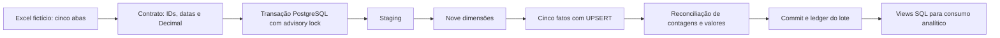

# Gestão Financeira — ETL dimensional com PostgreSQL

Pipeline financeiro em **Python, pandas, SQLAlchemy e PostgreSQL** que lê cinco
abas Excel, valida chaves e valores e publica um modelo dimensional com
**nove dimensões e cinco fatos**. Inclui dados fictícios, DDL versionado,
reconciliação financeira e testes de falhas com banco real.

O projeto demonstra preparação de dados para BI e Analytics Engineering.
Não exige arquivos ou bancos de uma empresa para ser avaliado.

## Problema e solução

Lançamentos distintos podem ter as mesmas dimensões. Deduplicar por cliente,
data e categoria pode eliminar valores legítimos. Da mesma forma, identificar
um título pelo seu valor ou status gera duplicação quando esses atributos mudam.

Este ETL usa IDs estáveis para lançamentos e títulos, valida o contrato de entrada
e reconcilia contagens e valores após os joins e UPSERTs. Staging, dimensões,
fatos e controle do lote ficam na mesma transação: uma falha reverte a publicação.



## Escopo financeiro

| Fato | Chave de negócio |
| --- | --- |
| Faturamento | ID_Lancamento |
| Custos/despesas | ID_Lancamento, em namespace separado do faturamento |
| Contas a receber | ID_Titulo |
| Orçamento | Data_Competencia + Tipo + Unidade_Negocio |
| Metas | Data_Competencia + Unidade_Negocio |

IDs distintos são preservados mesmo com valores e dimensões iguais. Reenviar a
mesma chave atualiza seus atributos. Ausência no Excel não exclui a linha do DW.
Duplicatas ambíguas dentro da mesma aba são rejeitadas, sem descarte ou soma automática.

O modelo é uma **constelação de fatos com dimensões compartilhadas**.
Consulte o [contrato das abas](docs/CONTRATO_DADOS.md) e a
[modelagem](docs/MODELAGEM.md) para campos, granularidade e relacionamentos.

## Demonstração reproduzível

Roteiro validado no Windows com Python 3.12.14 e PostgreSQL 18.6. Na raiz do
repositório, usando PowerShell e Python 3.12:

```powershell
python -m venv .venv
.\.venv\Scripts\python.exe -m pip install -r requirements-lock.txt
.\.venv\Scripts\python.exe -m pip check
.\.venv\Scripts\python.exe scripts/generate_sample.py
```

O gerador cria `data/demo/financeiro.xlsx`, sem sobrescrever arquivos existentes.
São 3 lançamentos de faturamento, 3 de custos, 2 orçamentos, 2 títulos e 2 metas.
Há lançamentos com a mesma combinação dimensional e títulos de valores iguais,
identificados por IDs diferentes.

Para executar a suíte completa e a demo, obtenha primeiro os binários portáteis
do PostgreSQL conforme o [guia de reprodução](docs/REPRODUCAO.md):

```powershell
$PgBin = (Resolve-Path '.local-test\runtime\pgsql\bin').Path
.\.venv\Scripts\python.exe -X utf8 scripts/validate_postgres.py --pg-bin "$PgBin" --demo
```

O script cria PostgreSQL e bancos descartáveis locais, testa as cargas e encerra
o servidor. Não instala serviço Windows e não precisa de `.env` ou contas
corporativas. O resumo fictício fica em `data/demo/latest_run.json` e os logs
locais em `.local-test/`. Binários precisam ser obtidos antes; não há download
automático no script.

Totais esperados da amostra: receita bruta **170.00**, impostos **17.00**,
receita líquida **153.00**, custos **35.30**, orçamento **250.00** e títulos **200.20**.
Esses números são fictícios, não resultados de uma operação real.

## Confiabilidade e testes

A suíte tem **55 testes: 30 unitários/configuração e 25 com PostgreSQL real**.
Em duas instalações novas no Windows, todos passaram, sem erros, falhas ou
testes ignorados. Veja [resultados e limites](docs/VALIDACAO.md).

Os testes verificam, entre outros comportamentos:

- Reprocessamento sem duplicação de chaves de negócio.
- Atualização de valor, status e atraso sem criar outro título.
- Preservação de lançamentos diferentes com dimensões iguais.
- Precisão monetária, totais, FKs e restrições de unicidade.
- Rollback de staging, dimensões, fatos e ledger após falhas.
- Detecção de perda em joins e divergência de valores.
- Concorrência, schema incompatível e recusa de objetos legados.
- Fluxo Excel → PostgreSQL e execução da CLI e da demonstração.

Sem PostgreSQL é possível executar:

```powershell
.\.venv\Scripts\python.exe -X utf8 scripts/run_tests.py
```

Nesse modo os casos PostgreSQL são informados como ignorados. **Não equivale à
validação completa.** O workflow preparado para GitHub Actions usa PostgreSQL
obrigatório e falha se houver testes omitidos. Sua primeira execução no GitHub
depende da publicação autorizada desta entrega.

## Organização

| Caminho | Responsabilidade |
| --- | --- |
| [src/ETL.py](src/ETL.py) | CLI e coordenação, sem carga na importação. |
| [src/contracts.py](src/contracts.py) | Leitura única do Excel, normalização e validação. |
| [src/model.py](src/model.py) | Mapeamento fechado entre origem, dimensões e fatos. |
| [src/warehouse.py](src/warehouse.py) | Inicialização, transação, locks, UPSERT e reconciliação. |
| [src/config.py](src/config.py) | Configuração por ambiente, sem credenciais predefinidas. |
| [sql/001_schema.sql](sql/001_schema.sql) | DDL, chaves, restrições, índices e três views analíticas. |
| [examples/synthetic.py](examples/synthetic.py) | Fonte inteiramente fictícia e gerador Excel. |
| [scripts/](scripts/) e [tests/](tests/) | Demonstração e validação automatizada. |
| [.github/workflows/tests.yml](.github/workflows/tests.yml) | CI preparado para Python e PostgreSQL descartável. |

## Configuração própria

Para adaptar o ETL a dados sob sua autorização, veja [.env.example](.env.example),
[SECURITY.md](SECURITY.md) e o [procedimento](docs/REPRODUCAO.md).
`python src/ETL.py --init` inicializa e encerra; a carga é outro comando:
`python src/ETL.py --input caminho/arquivo.xlsx`.

A versão anterior não fornecia IDs estáveis nem DDL reproduzível. O novo contrato
exige adaptação explícita do arquivo de origem e banco novo. Não há migração
automática do banco ou dos arquivos de uma empresa anterior.

## Limites e escolhas

- A origem é relida integralmente. UPSERT no destino não é extração incremental.
- As cargas não excluem fatos ausentes, não criam histórico SCD e não guardam
  versões antigas das linhas. O ledger registra métricas de lotes bem-sucedidos.
- Dimensões por nome são um contrato demonstrativo; homônimos precisam de IDs
  cadastrais numa evolução do projeto.
- Valores usam uma unidade monetária comum, sem conversão cambial. Convenções
  de sinais e percentuais estão no contrato, não são regras de uma empresa real.
- Não há benchmark com volume produtivo, homologação empresarial ou teste macOS.
- Não há `.pbix`, DAX ou dashboard publicado. As views não calculam EBITDA sem
  regras contábeis explícitas. O projeto não implementa modelos preditivos.
- A revisão atual não remove o histórico de credenciais já expostas; esse trabalho
  requer autorização e coordenação separadas.

## Competências demonstradas

Python, pandas, SQL, PostgreSQL, modelagem dimensional, chaves de negócio,
UPSERT, transações, reconciliação financeira, testes de integração, configuração
por ambiente e preparação de CI. As evidências de execução estão separadas de
funcionalidades planejadas e alegações de desempenho.
