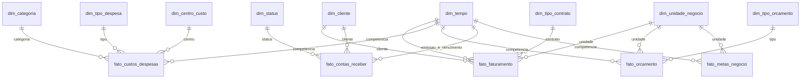

# Modelo dimensional demonstrativo

O modelo é uma **constelação de fatos com dimensões compartilhadas**. O DDL é
[sql/001_schema.sql](../sql/001_schema.sql). Não há hierarquias dimensionais
normalizadas que justifiquem chamar esta implementação de Snowflake.

Todas as tabelas-fato têm uma PK substituta `row_id`, chave de negócio UNIQUE,
FKs obrigatórias e referência ao lote da última atualização. A dimensão tempo usa
chave AAAAMMDD; as demais têm identidade numérica e atributo natural único.
Índices cobrem FKs e lote para suportar joins e reconciliação. Não há benchmark
que permita classificá-los como otimização comprovada para volume produtivo.

## Views disponíveis

- `dw.vw_faturamento_mensal`: receitas e impostos por mês e unidade.
- `dw.vw_custos_mensais`: despesas por mês e categoria.
- `dw.vw_contas_receber_status`: quantidade de títulos e valor por status.

As views agregam fatos separadamente para evitar fan-out entre fatos. Não há
view de EBITDA ou realizado versus orçado que pressuponha categorias e sinais
financeiros não definidos. Metas percentuais não devem ser somadas como dinheiro.

O arquivo `modelagem_dw.png` é um diagrama legado da versão anterior. Não é o
contrato da versão atual. Este documento e o DDL são as referências mantidas.

## Inicialização e evolução

`python src/ETL.py --init` cria os objetos apenas em schemas stg/dw vazios.
Reexecutar com a mesma versão e hash de DDL é permitido, sem apagar dados.
Schemas legados ou versão divergente são recusados. O hash normaliza finais de
linha para Windows/Linux, mas não constitui inspeção completa contra alterações
manuais no banco. Mudanças manuais incompatíveis falham na carga e devem ser
tratadas por migração explícita, não por DROP/CREATE automático.

Consulte [CONTRATO_DADOS.md](CONTRATO_DADOS.md) para granularidade, precisão e
política de atualização, ausência de chaves e rastreabilidade.
